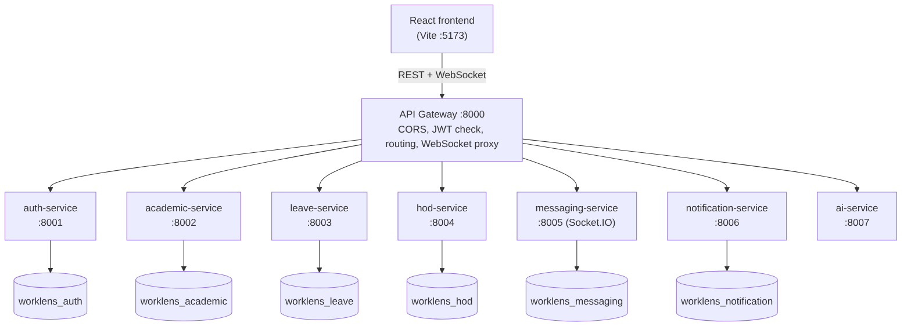
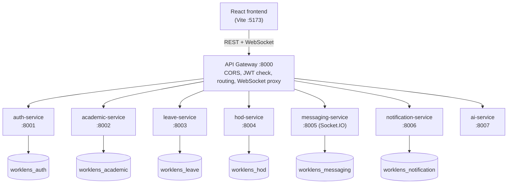

# WorkLens: Microservices Architecture

> **Status:** Phase 0 (design and scaffolding). The existing monolith in `backend/` still runs unchanged.
> Services are extracted one phase at a time, see [Migration phases](#migration-phases).

## 1. Why split

WorkLens started as one Express app (`backend/server.js`) mounting every route, with one MongoDB
connection and models shared through `require("../../../shared/models/...")`. The goal is to turn it into
independently running services that each own their data, behind one API gateway.

## 2. Target architecture





The service-to-service calls (`/internal/*`) are listed in the table below instead of drawn, to keep the picture readable.

### Service-to-service calls

| Caller | Calls | Why |
|---|---|---|
| academic | notification | assignment, class and enrolment notifications |
| academic | leave | pending-approvals count on the dashboard |
| academic | ai | lesson-plan generation |
| leave | academic | courses, assignments and classes affected by a leave |
| leave | notification | leave submitted, approved, rejected |
| hod | academic | courses, attendance, assignments, classes, syllabus progress |
| hod | leave | leaves by department and date |
| hod | auth | faculty users and profiles |
| hod | notification | tasks, reminders, allocation notices |
| messaging | auth | user and department lookup (only if not in the JWT) |

### Rules every service follows

1. **Own your data.** A service reads and writes only its own database. No other service connects to it.
2. **No cross-service `require`.** Never import another service's model or controller. Call its `/internal/*` API.
3. **IDs, not populate.** Store the other service's `_id` (for example `courseId`). `populate()` cannot cross services.
4. **Gateway is the only public door.** Services trust the gateway-forwarded identity headers
   (`x-user-id`, `x-user-role`, `x-user-dept`) and must not be reachable from the internet directly.
5. **Notifications are fire-and-forget.** A failed notification must never fail the main request.
6. **Config per service.** Each service has its own `.env`. Secrets such as `GEMINI_API_KEY` go only where needed.

## 3. Service ownership

| Service | Port | Database | Owns (current monolith location) |
|---|---|---|---|
| **api-gateway** | 8000 | none | Routing, CORS, JWT verification, WebSocket proxy |
| **auth-service** | 8001 | `worklens_auth` | `User` (shared with the backend until the last phase); `authController`, `settingsController`; `signToken`, now with `dept` in the token. **Phase 2 done.** |
| **academic-service** | 8002 | `worklens_academic` | `Course`, `Attendance`, `Assignment`, `Syllabus`, `OnlineClass`, `LessonPlan`, `StudyMaterial`, `ActivityLog`, `ExtraDuty`; teaching controllers for courses, attendance, assignments, syllabus, timetable, lesson plans, study materials, online classes, extra duties, dashboard, activity logs |
| **leave-service** | 8003 | `worklens_leave` | `Leave`, `LeaveBalance`, `Holiday`; `teaching/controller/leaveController`, `hod/controller/hodLeaveController` |
| **hod-service** | 8004 | `worklens_hod` | `CourseAllocation` models (including `FacultyProfile`), `DutyAllocation`, `ReportSnapshot`, `WorkflowAction`, `HodModels` (tasks, papers, escalations, deadlines, availability, substitutions); `hodController`, `facultyProfileController`, `courseAllocationController`, `dutyAllocationController`, `hodWorkloadController`, `hodReportController`, `workflowInsightsController` |
| **messaging-service** | 8005 | `worklens_messaging` | `DeptConversation`, `DeptMessage`, `DeptAnnouncement`, `Message`; `deptMessageController`, `messageController`; `shared/utils/socket`, `deptChat` |
| **notification-service** | 8006 | `worklens_notification` | `Notification`; `notificationController`. **Phase 2 done.** |
| **ai-service** | 8007 | none | `aiController` (Google Gemini lesson-plan generation). **Phase 2 done.** |

## 4. Gateway route map

Order matters: more specific paths are matched first.

| Path prefix | Target |
|---|---|
| `/api/auth`, `/api/settings` | auth-service |
| `/api/courses`, `/api/attendance`, `/api/assignments`, `/api/syllabus`, `/api/timetable`, `/api/lesson-plans`, `/api/study-materials`, `/api/online-classes`, `/api/dashboard`, `/api/activity-logs`, `/api/workflow`, `/api/duties` | academic-service |
| `/api/leaves`, **`/api/hod/leaves`** | leave-service |
| `/api/hod`, `/api/faculty-profile` | hod-service |
| `/api/dept-messages`, `/api/messages`, `/socket.io` (WebSocket) | messaging-service |
| `/api/notifications` | notification-service |
| `/api/ai` | ai-service |

`/api/hod/leaves/*` must be registered **before** `/api/hod`, because the HOD router currently mixes leave
endpoints in with the rest of the HOD routes.

## 5. Known coupling to remove (from the code review)

| # | Problem in the monolith | Resolution |
|---|---|---|
| 1 | `Course` is `require`d in 16 files, `User` in 14, `Notification` in 10, `Leave` in 10 | Owner exposes `/internal/*`; callers use HTTP |
| 2 | `authenticate` loads the `User` from the DB on every request | Gateway verifies the JWT once and forwards identity headers; `dept` is now in the token (Phase 2). The backend lookup goes away as modules are extracted |
| 3 | Notifications are created inline in 14 places in 11 controllers | **Done (Phase 2):** `backend/shared/models/Notification.js` is now an HTTP client with the same `create` / `insertMany` calls, so no controller changed |
| 4 | `hodController.js` (1343 lines) reads Course, Attendance, Assignment, OnlineClass, Leave directly | hod-service calls academic and leave `/internal` endpoints and combines the results |
| 5 | `Course.allocationId` and `CourseAllocation.courseRef` reference each other | Keep the plain ID on both sides, no `populate` |
| 6 | `Syllabus.populate("courseId")` | Syllabus and Course stay together in academic-service |
| 7 | Socket.IO handshake reads `User` and `deptChat` rules | Moves to messaging-service; gateway proxies WebSocket; department comes from the token |
| 8 | `FacultyProfile` is defined in the HOD course-allocation model file and used by `facultyProfileController` | Stays with HOD: `/api/faculty-profile` moves to hod-service, not auth-service |
| 9 | `WORKFLOW_ANON_SECRET` is used by the dashboard controller (academic) and workflow insights (HOD) | Same value in both services' `.env` |
| 10 | `portals/teaching/models/Faculty.js` is never imported | Dead code, drop it during migration |

## 6. Decisions taken along the way

| Decision | Why |
|---|---|
| Per-service copies of the small token helper instead of `libs/common` | Docker builds each service from its own folder, and a shared package outside it complicates that. The helper is about 30 lines |
| Internal key derived from `JWT_SECRET` | `/internal/*` needs protection even if a service port is reachable, and this adds no new setting to manage |
| `users` collection shared by backend and auth-service until the last phase | 14 backend files read `User` directly (HOD, leave, chat). They move to `/internal/users` as their modules are extracted |
| ai-service gets the course through the courses API with the caller's token | No database for it, and the same access rules as everywhere else |

## 7. Migration phases

| Phase | Result you can demo |
|---|---|
| **0** | This document, folder structure, `docker-compose.yml` (monolith + MongoDB) |
| **1** | Gateway on :8000 in front of the monolith (moved to :9000) |
| **2** | auth, notification and ai as independent services (done) |
| **3** | messaging-service with real-time chat (done) |
| **4** | leave-service and academic-service |
| **5** | hod-service, monolith deleted |
| **6** | Dockerfile per service, `docker compose up` runs everything |

## 8. Repository layout

```
WorkLens/
├── backend/              existing monolith (kept running until Phase 5)
├── frontend/             React app, only VITE_API_URL changes
├── gateway/              Phase 1
├── services/
│   ├── auth-service/         Phase 2
│   ├── notification-service/ Phase 2
│   ├── ai-service/           Phase 2
│   ├── messaging-service/    Phase 3
│   ├── leave-service/        Phase 4
│   ├── academic-service/     Phase 4
│   └── hod-service/          Phase 5
├── docs/ARCHITECTURE.md
├── docker-compose.yml
└── .env.example
```
